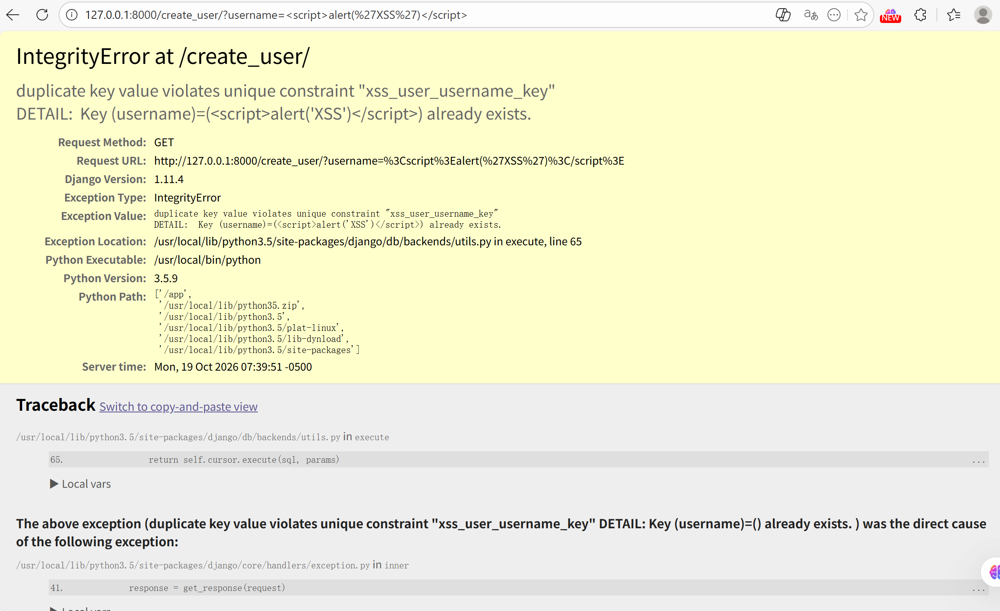

# Lab1 Secure REST API

## Project & API description

Technology stack: Python Flask + SQLite + SQLAlchemy ORM
Endpoints:

1. POST /auth/register
- Input JSON: {"username":"xxx","password":"xxx"}
- Register new user, store bcrypt hashed password. Return 201 when success.
2. POST /auth/login
- Input JSON: {"username":"xxx","password":"xxx"}
- Return JWT access‑token for authenticated users.
3. GET /api/data
- Protected endpoint, Header: Authorization: Bearer <token>
- Return list of users.

## Implemented security measures

1. SQL Injection protection:
   Use SQLAlchemy ORM, no manual string concatenation for SQL queries. ORM automatically uses parameterized prepared statements.

2. XSS protection:
   Use markupsafe.escape() function to escape all user‑origin output data before returning in JSON responses.

3. Broken Authentication protection:
- Passwords are stored as bcrypt hash, never plaintext.
- After successful login, server issues JWT token with expiration time.
- Custom token_required middleware validates JWT on every protected API call. Access is denied without valid token.

## SAST & SCA scan reports


## Selected CVE information

CVE‑ID: CVE‑2017‑12794

Brief description: Django versions prior to 1.11.5 and 1.10.8 contain a reflected cross‑site‑scripting (XSS) vulnerability. When `DEBUG=True` is enabled, the debug error page renders database‑generated error messages without proper HTML escaping. Malicious JavaScript stored in database can be executed in victim’s browser when database constraint error occurs.

## CVE reproduction steps

Execute the following commands to build and start the vulnerable Django application:

```
D:
cd D:\vulhub-env\vulhub\django\CVE-2017-12794
docker-compose up -d
```


After the server starts, first request creates a user with malicious javascript payload:

```
http://127.0.0.1:8000/create_user/?username=<script>alert('XSS')</script>
```


Send the identical request a second time to trigger database unique constraint error:




## Root‑cause analysis

This reflected XSS vulnerability only occurs under Django `DEBUG=True` mode.
When duplicate username is submitted, database throws unique constraint conflict error. The raw error message fetched from database, which contains user‑controlled malicious content, is printed onto debug HTML page without output sanitization.
The injected JavaScript tags are parsed and executed by browser. Attackers could abuse this flaw to steal cookies or hijack user sessions. This vulnerability only affects debug mode and will not appear in production environment with debug turned off. Simple keyword blacklist filtering cannot fully defend against this risk because multiple bypass techniques exist.

## Applied fix description

Two effective mitigations:

1. Disable DEBUG mode in production: Set `DEBUG = False` in Django settings. Detailed debug error pages will not be exposed to users.

2. Upgrade Django to fixed versions: 1.10.8 or 1.11.5 and above. The new versions add proper HTML escaping for database error content on debug pages.


## Proof of fix


