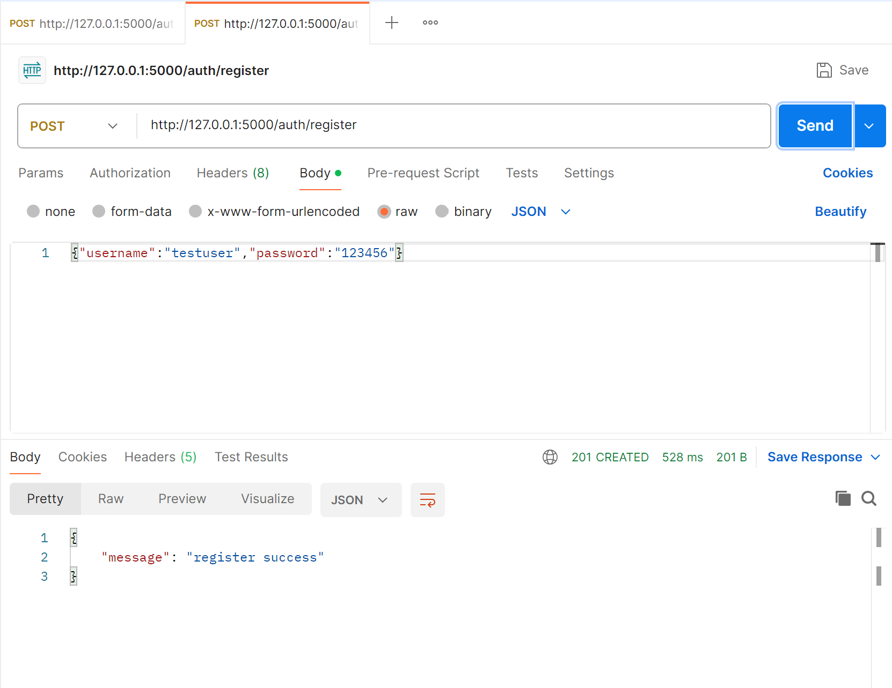
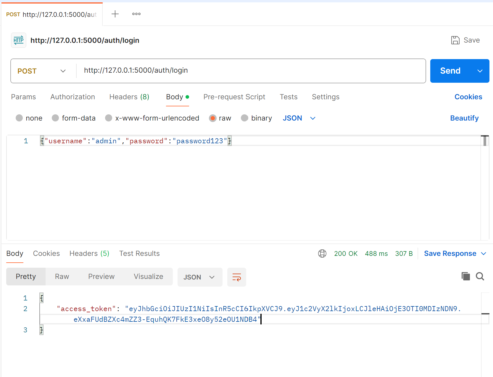
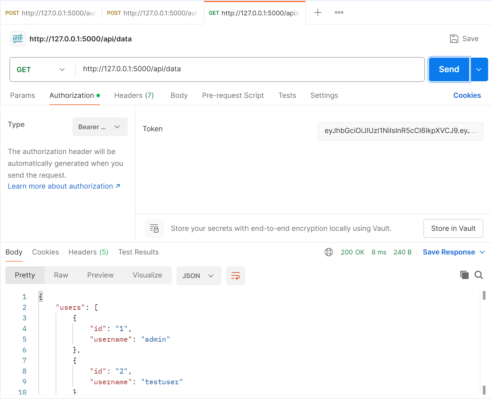
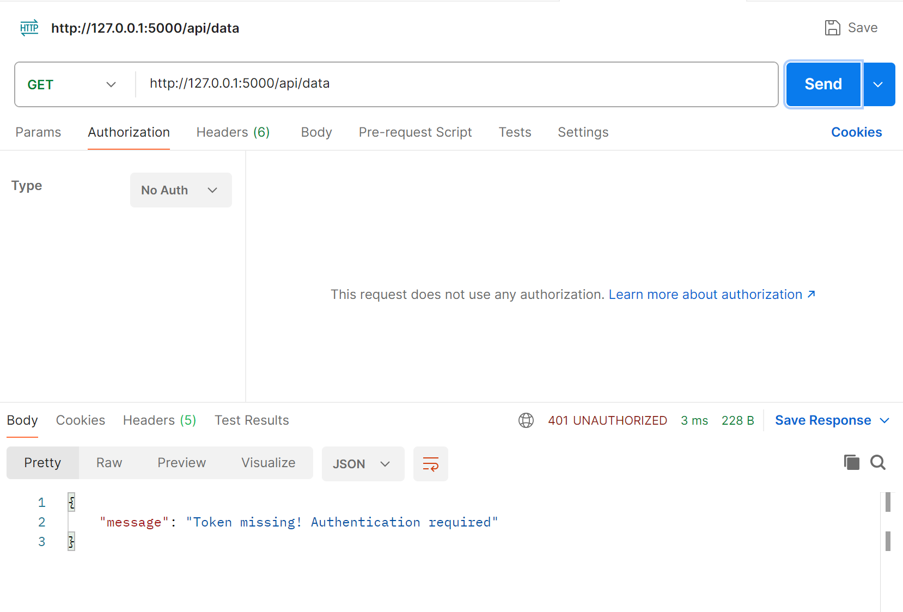
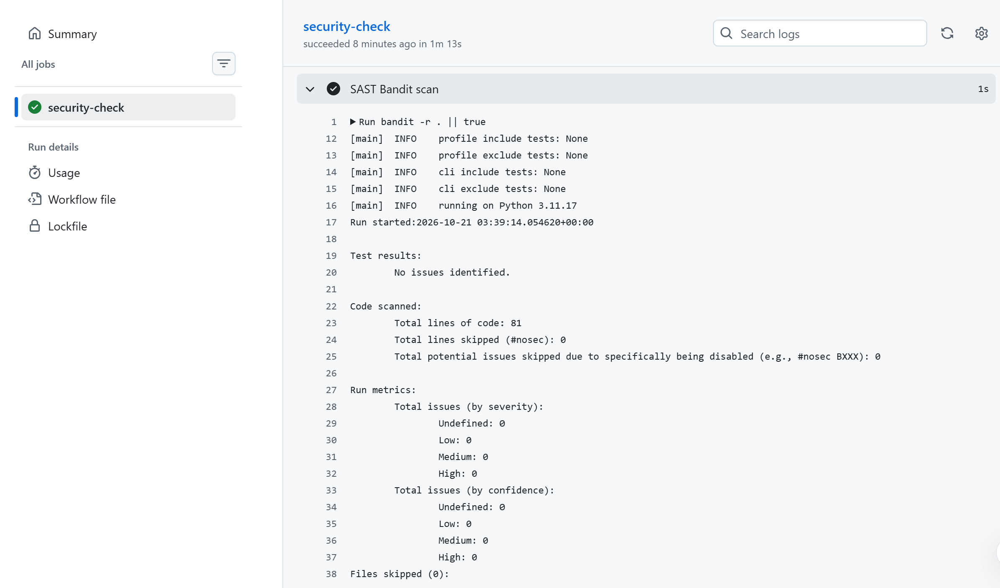
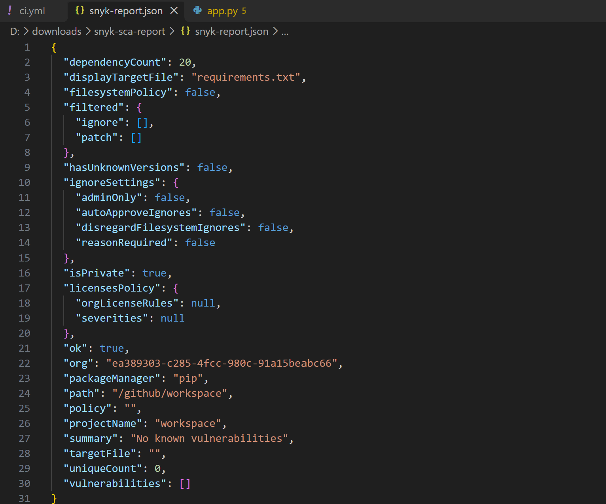

# Lab1 Secure REST API Development with CI/CD and Real CVE Vulnerability Analysis

## Project & API description

Technology stack: Python Flask + SQLite + SQLAlchemy ORM

Environment:

```
Docker version 29.8.2
Docker Compose v5.6.0
git version 2.45.1.windows.1
Python 3.13.9
Postman x86_64 11.51.5
```

Endpoints:

1. POST /auth/register
- Input JSON: {"username":"xxx","password":"xxx"}
- Register new user, store bcrypt hashed password. Return 201 when success.
  
2. POST /auth/login
- Input JSON: {"username":"xxx","password":"xxx"}
- Return JWT access‑token for authenticated users.
  
3. GET /api/data
- Protected endpoint, Header: Authorization: Bearer <token>
- Return list of users.
  
  

## Implemented security measures

1. SQL Injection protection:
   Use SQLAlchemy ORM, no manual string concatenation for SQL queries. ORM automatically uses parameterized prepared statements.

2. XSS protection:
   Use markupsafe.escape() function to escape all user‑origin output data before returning in JSON responses.

3. Broken Authentication protection:
- Passwords are stored as bcrypt hash, never plaintext.
- After successful login, server issues JWT token with expiration time.
- Custom token_required middleware validates JWT on every protected API call. Access is denied without valid token.

## SAST & SCA scan reports





## Selected CVE information

CVE‑ID: CVE‑2017‑12794

Brief description: Django versions prior to 1.11.5 and 1.10.8 contain a reflected cross‑site‑scripting (XSS) vulnerability. When `DEBUG=True` is enabled, the debug error page renders database‑generated error messages without proper HTML escaping. Malicious JavaScript stored in database can be executed in victim’s browser when database constraint error occurs.

## CVE reproduction steps

Execute the following commands to build and start the vulnerable Django application:

```
D:
cd D:\vulhub-env\vulhub\django\CVE-2017-12794
docker-compose up -d
```


After the server starts, first request creates a user with malicious javascript payload:

```
http://127.0.0.1:8000/create_user/?username=<script>alert('XSS')</script>
```


Send the identical request a second time to trigger database unique constraint error:


## Root‑cause analysis

According to CVE-2017-12794 records from NVD and MITRE CVE database, this vulnerability arises from a combination of configuration issue and improper output sanitization, rather than classic application-level logic error or insufficient input filtering.

In the vulhub test environment, the Django application is started with `DEBUG=True` in app.py. When a duplicate username is submitted, the database raises an `IntegrityError` unique-constraint violation exception. Django’s built-in debug error page renders the raw database error message directly onto HTML. This error message contains user-controlled username value read from database, and no HTML escaping is applied during output rendering.

User-supplied JavaScript payload inside the database error message is therefore interpreted as HTML script tags by the browser instead of plain-text. This leads to reflected cross-site-scripting.

The vulnerability condition strictly depends on debug mode being enabled. In production configuration with `DEBUG=False`, detailed database error details are never exposed to end-users, so this flaw cannot be triggered.

Reviewing the official Django security patch: developers added HTML-escape processing for database exception content displayed on debug pages. Filtering or blacklisting user input cannot serve as an effective mitigation for this vulnerability, because the root defect lies in unsafe output on debug error pages, not unsafe input acceptance. Attackers may abuse this XSS to steal victim cookies or perform session-hijacking attacks.

## Applied fix description

Modified the file `app.py`. Changed the line `DEBUG = True` to `DEBUG = False`.This vulnerability relies entirely on Django’s detailed debug error page being exposed to users. When `DEBUG=False`, Django disables the full debug error interface. Raw unsanitized database exception messages will no longer be rendered in HTML and returned to web clients. Since the attack surface that triggers the XSS is removed, the vulnerability cannot be exploited, even if malicious-controlled data exists inside the database.


## Proof of fix


